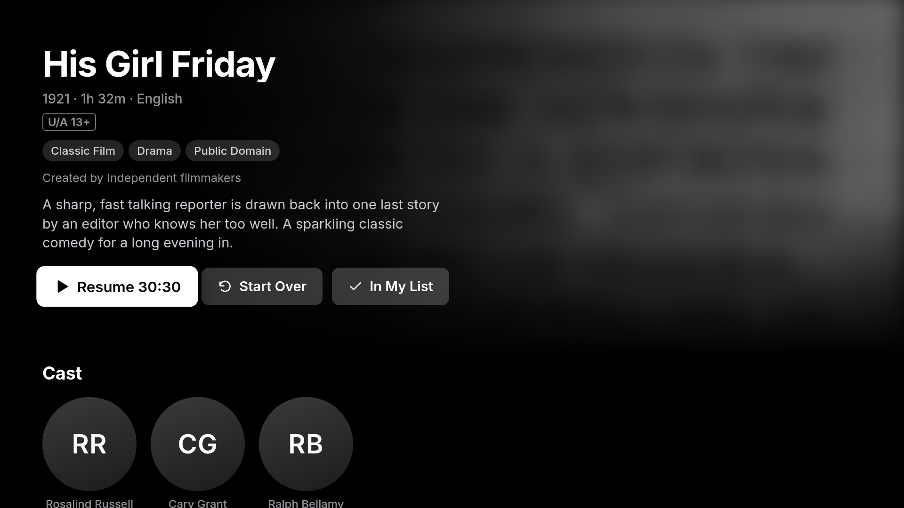

# Couch TV

[](https://github.com/aabhiojha/couch-tv/actions/workflows/check.yml)
[](LICENSE)


**A fast, remote-first streaming app for Samsung smart TVs.** Browse films and series from TMDB, then play
them from the sources *you* choose: Stremio add-ons (torrents stream on the TV itself), your own stream
server, and IPTV playlists for live sports. Couch TV ships no content and no sources of its own.


## Contents

- [Features](#features)
- [How it works](#how-it-works)
- [Getting started](#getting-started)
- [Installation](#installation)
- [Configuration](#configuration)
- [Usage](#usage)
- [Updating](#updating)
- [Development](#development)
- [Project structure](#project-structure)
- [Documentation](#documentation)
- [FAQ](#faq)
- [Roadmap](#roadmap)
- [Contributing](#contributing)
- [Disclaimer](#disclaimer)
- [License and credits](#license-and-credits)

## Features

- **Made for the remote.** Every screen works with the arrows, OK, Back and the media keys. Press ▶ Play on any
  title card to start it straight away.
- **A full catalog.** Trending, popular and top-rated films and series from TMDB, genre and language filters,
  search with recent searches, cast pages, and More Like This.
- **Picks up where you left off.** Continue Watching, resume points, the next episode in a series, and
  Because You Watched recommendations. My List keeps the titles you save.
- **Torrents on the TV.** A built-in torrent engine runs on the TV, so torrent results from your add-ons play
  without a computer or a separate server.
- **Bring your own sources.** Stremio add-ons, any [OMSS](https://github.com/omss-spec/omss-spec) stream server
  (such as a self-hosted [CinePro Core](https://github.com/cinepro-org/core)), M3U playlists for live sports
  channels, and a sports schedule relay.
- **A proper player.** Subtitles and audio tracks, quality choice, Up Next with autoplay, seeking by
  percentage with the digit keys, and automatic fallback to the next source if a stream fails.
- **Live sports.** Cricket and football channels from your playlists, plus an On now / Today / Upcoming schedule
  when a sports relay is set up. Other channels in a playlist are left out.
- **Light on the TV.** Plain JavaScript with no frameworks and no runtime dependencies, tuned for a 1 GB TV
  running Chromium 76.



## How it works

```
                 TMDB  ── catalog, artwork, seasons, recommendations
                   │
   ┌──────── Couch TV (web app on the TV) ────────┐
   │                                              │
   ├── Stremio add-ons ──► torrent ──► torrent engine on the TV (port 11470)
   │                   └─► direct link ──► player
   ├── your stream server (OMSS) ──► player
   ├── M3U playlists ──► Sports (cricket and football channels)
   └── sports relay ──► Sports
```

The app is a Tizen web app (`web/`). The torrent engine is a small .NET service (`tv-service/`) installed
next to it on the TV. Your settings, history and lists stay on the TV.

## Getting started

You need:

- A **Samsung smart TV from 2019 or later** (Tizen 5+). Tested on a 2021 AU7700 (Tizen 6.0).
- A **computer** on the same network (Linux or macOS) with
  [Tizen Studio](https://developer.tizen.org/development/tizen-studio/download), Node.js 22+, Python 3 and,
  for torrents, the [.NET 8 SDK](https://dotnet.microsoft.com/download).
- A free **[Samsung account](https://account.samsung.com)**, to make your signing certificate.
- A free **[TMDB API key](https://www.themoviedb.org/settings/api)**.
- **Sources** to watch from: Stremio add-on links, a stream server, or IPTV playlists.

Want to look around first? Run the app in your browser with sample public-domain titles, with no TV or keys
needed:

```sh
git clone https://github.com/aabhiojha/couch-tv.git
cd couch-tv/web && python3 -m http.server 8000
# open http://localhost:8000/dev.html in a 1920×1080 window; arrows, Enter = OK, Esc = Back
```

## Installation

Couch TV isn't in Samsung's app store. You install it with your TV's **Developer Mode**, signed with your own
free Samsung certificate. **[INSTALL.md](INSTALL.md) walks you through every step.** In short:

1. Install Tizen Studio with **TV Extensions** and **Samsung Certificate Extension**.
2. On the TV: **Apps** → type `12345` → **Developer mode** On → **Host PC IP** = your computer's IP → restart.
3. Connect: `~/tizen-studio/tools/sdb connect <TV IP>`.
4. In Certificate Manager, create a **Samsung → TV** certificate profile named `couch`, with the TV connected.
5. Configure and install:
   ```sh
   cp web/js/secrets.example.js web/js/secrets.js   # add your TMDB key and sources
   TV=<TV IP> ./build.sh install                     # test, sign, install and open it on the TV
   ```

## Configuration

Everything is set in `web/js/secrets.js` (copy it from
[`secrets.example.js`](web/js/secrets.example.js)). Git ignores this file, so your keys and IPTV logins stay
on your computer and your TV. After changing it, run the install command again.

| Setting | What it does |
|---|---|
| `tmdbKey` | **Required.** Your TMDB v3 API key, for the catalog, artwork and search. |
| `addons` | Stremio add-on links (`…/manifest.json`). Torrent results play through the engine on the TV; direct links play as they are. |
| `provider` | Address of an [OMSS](https://github.com/omss-spec/omss-spec) stream server on your network, for films and episodes. |
| `playlists` | M3U links whose cricket and football channels appear on the Sports screen, including an IPTV provider's `get.php?username=…&password=…` link. Default: iptv-org's free sports channels. |
| `sportsRelay` | A server for the Sports schedule. |
| `torrentServer` | Use another torrent server instead of the one on the TV. |

```js
window.COUCH_SECRETS = {
  tmdbKey: 'your-tmdb-key',
  addons: ['https://your-addon.example/manifest.json'],
  provider: 'http://192.168.1.20:3000',
  playlists: ['http://your-iptv.example/get.php?username=…&password=…&type=m3u_plus']
};
```

Without `addons` or a `provider`, playing a title says *No sources set up*. [Sources](docs/streaming-provider.md)
documents each one, including the stream server and sports relay APIs if you want to write your own.

## Usage

| Key | On a screen | In the player |
|---|---|---|
| Arrows | Move | Seek (Left/Right), controls (Up/Down) |
| OK | Open | Play / pause |
| Back | Back, then the tab bar, then Home | Hide controls, then close |
| ▶ Play | Play the title straight away | Play / pause |
| ⏪ ⏩ | | Seek in bigger steps |
| 0–9 | | Jump to 0 %, 10 % … 90 % |
| ■ Stop | | Close the player |

In **Settings** you can choose to be asked *Torrent or Web stream* before each title, set the source order,
default quality, subtitles and their size, turn off animations, set a sleep timer (with the
[Home launcher](https://github.com/aabhiojha/tv-shinnagans) installed), test your torrent engine
and stream server, and clear your history or My List. The [user guide](docs/user-guide.md) covers every
screen.

## Updating

```sh
git pull
TV=<TV IP> ./build.sh install
```

Installing over the old version keeps your watch history, My List and settings.

## Development

```sh
./build.sh                                                # JS tests + Chromium 76 compatibility check
dotnet test tv-service/CouchTor.Tests/CouchTor.Tests.csproj   # torrent engine tests
cd web && python3 -m http.server 8000                     # dev.html (sample data), player-dev.html, index.html (real)
```

- The app targets **Chromium 76** (ES2019) and a fixed **1920×1080** screen. `tools/check-js.js` fails the
  build on syntax or CSS the TV doesn't support; it needs `acorn` (`npm install --no-save acorn@8.12.1`).
- No frameworks and no runtime dependencies: each file in `web/js` is a plain script that attaches one global.
- Tests are plain Node scripts using `assert`; CI runs them and the .NET tests on every push and pull request.
- `tools/shot.js` drives the app in headless Chrome with remote keys and saves screenshots.

[Development](docs/development.md) has the details, the code rules for `web/`, and how to debug on the TV.

## Project structure

```
couch-tv/
├── web/                  the TV app (Tizen web app)
│   ├── index.html        entry point; dev.html and player-dev.html are desktop previews
│   ├── config.xml        Tizen manifest (app ID, privileges)
│   ├── css/
│   └── js/
│       ├── main.js       wires everything together
│       ├── data.js       catalog + library (history, My List, settings)
│       ├── pstream.js    TMDB and stream server client
│       ├── addons.js     Stremio add-on client and ranking
│       ├── live.js       sports channels from playlists, and the sports schedule
│       ├── player.js     the player (AVPlay on the TV)
│       ├── shell.js      navigation and focus; kit.js has UI building blocks
│       ├── screens/      home, browse, search, details, person, live, settings
│       └── secrets.example.js
├── tv-service/           the torrent engine that runs on the TV (.NET, MonoTorrent)
├── tests/                Node tests
├── tools/                compatibility check, screenshots, TV performance tracing
├── docs/                 user guide, architecture, development, sources, deployment
├── build.sh              test, and with `install`, build, sign and install on the TV
└── INSTALL.md            step-by-step installation
```

## Documentation

| Document | For |
|---|---|
| [INSTALL.md](INSTALL.md) | Installing on your TV, step by step |
| [User guide](docs/user-guide.md) | Every screen and control |
| [Sources](docs/streaming-provider.md) | Setting up sources; the stream server and sports relay APIs |
| [Architecture](docs/architecture.md) | How the app is put together |
| [Development](docs/development.md) | Running, testing and debugging |
| [Deploying to the TV](docs/deployment.md) | What the install does; TV commands and troubleshooting |
| [Torrent service](docs/tv-torrent-service.md) | The engine on the TV and its HTTP API |

## FAQ

**Is it in the Samsung app store?** No. You install it through Developer Mode; see [INSTALL.md](INSTALL.md).

**Can I use someone else's certificate?** No. A Samsung TV certificate only works on the TVs whose IDs it lists,
and it holds private keys, so everyone makes their own (it's free).

**Does it come with anything to watch?** No. You add your own sources in `web/js/secrets.js`.

**Do I need a computer running to watch?** No for add-ons and IPTV: torrents stream on the TV. Only your own
stream server or sports relay, if you use them, have to be running.

**Will it work on my TV?** Samsung TVs from 2019 on (Tizen 5+) should work; only a 2021 AU7700 has been tested.
Please [open an issue](https://github.com/aabhiojha/couch-tv/issues) to say how it went on yours.

**The app disappeared.** Developer Mode was turned off or the TV was reset. Turn it back on and install again.

More fixes are in [INSTALL.md › If something goes wrong](INSTALL.md#if-something-goes-wrong).

## Roadmap

- [Add sources from Settings on the TV, without rebuilding](https://github.com/aabhiojha/couch-tv/issues/1)
- Reports from more TV models and years
- Other platforms (Android TV / Google TV)

## Contributing

Issues and pull requests are welcome.

1. Fork the repository and create a branch.
2. Make your change. Keep to the [code rules](docs/development.md) for `web/`: ES2019, no dependencies, one
   global per file.
3. Run `./build.sh` and `dotnet test tv-service/CouchTor.Tests/CouchTor.Tests.csproj`; add a test for new logic.
4. Open a pull request saying what changed and which TV model you tested on, if any.

Never commit `web/js/secrets.js`, signing profiles or certificates.

## Disclaimer

Couch TV is a player. It includes no content and no stream sources, and isn't affiliated with Samsung, TMDB or
Stremio. You're responsible for the sources you add and for following the laws where you live.

## License and credits

[MIT](LICENSE).

- Film and series data and artwork from [TMDB](https://www.themoviedb.org). This product uses the TMDB API but
  is not endorsed or certified by TMDB.
- Torrents by [MonoTorrent](https://github.com/alanmcgovern/monotorrent) (MIT), vendored in
  `tv-service/vendor/monotorrent`.
- Add-ons use the [Stremio add-on protocol](https://github.com/Stremio/stremio-addon-sdk); stream servers use
  [OMSS](https://github.com/omss-spec/omss-spec).
