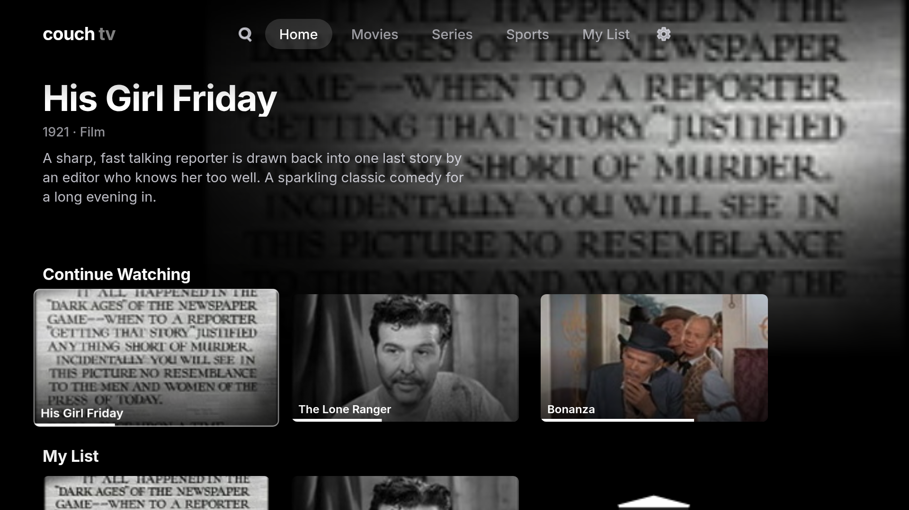

# Couch TV

[](https://github.com/aabhiojha/couch-tv/actions/workflows/check.yml)
[](LICENSE)

A streaming app for Samsung smart TVs. Browse films and series, then watch them from **your own sources**:
Stremio add-ons, your own stream server, or IPTV playlists. Couch TV comes with no content and no sources.



## What it does

- Films and series from TMDB: trending, popular, genres, search and cast pages.
- Continue Watching, My List, next episode and recommendations.
- Torrents stream on the TV itself. No computer needed while you watch.
- Subtitles, quality choice, autoplay of the next episode, and automatic retry with another source.
- Live cricket and football from your playlists.
- Works entirely with the TV remote.

## What you need

- A Samsung smart TV from 2019 or newer.
- A computer (Linux or macOS) on the same Wi-Fi or network as the TV.
- A free [Samsung account](https://account.samsung.com) and a free [TMDB API key](https://www.themoviedb.org/settings/api).
- Something to watch from: Stremio add-on links, a stream server, or an IPTV playlist.

## Install

Couch TV isn't in the Samsung app store. You install it yourself with the TV's Developer Mode.
**Follow [INSTALL.md](INSTALL.md)**. It takes about 30–60 minutes the first time.

Once set up, installing is one command:

```sh
TV=<your TV's IP> ./build.sh install
```

## Add your sources

Copy the example settings file and fill it in:

```sh
cp web/js/secrets.example.js web/js/secrets.js
```

```js
window.COUCH_SECRETS = {
  tmdbKey: 'your-tmdb-key',                                  // required
  addons: ['https://your-addon.example/manifest.json'],      // Stremio add-ons
  provider: 'http://192.168.1.20:3000',                      // your stream server
  playlists: ['http://your-iptv.example/playlist.m3u']       // IPTV (cricket and football channels)
};
```

Then install again. Your settings stay on your computer and your TV. They are never uploaded.
[Sources](docs/streaming-provider.md) explains each setting.

## Use

| Remote key | What it does |
|---|---|
| Arrows, OK | Move, open |
| Back | Go back |
| ▶ Play | Start a title straight away |
| ⏪ ⏩ | Rewind, fast-forward |
| 0–9 | Jump to 0 %, 10 % … 90 % of a title |

The [user guide](docs/user-guide.md) covers every screen.

## Update

```sh
git pull
TV=<your TV's IP> ./build.sh install
```

Your history, My List and settings are kept.

## Help

- Something not working? See [If something goes wrong](INSTALL.md#if-something-goes-wrong).
- App disappeared? Developer Mode was turned off. Turn it on and install again.
- Still stuck? [Open an issue](https://github.com/aabhiojha/couch-tv/issues) with your TV model.

## Contributing

Pull requests are welcome. Run `./build.sh` before opening one, and say which TV you tested on.
The [docs](docs/README.md) explain how the app is built and tested.

## Disclaimer

Couch TV is only a player. It has no content and no sources, and isn't affiliated with Samsung, TMDB or
Stremio. You're responsible for the sources you add.

## License

[MIT](LICENSE). Uses [MonoTorrent](https://github.com/alanmcgovern/monotorrent) (MIT) for torrents.
Film and series data from [TMDB](https://www.themoviedb.org). This product uses the TMDB API but is not
endorsed or certified by TMDB.
