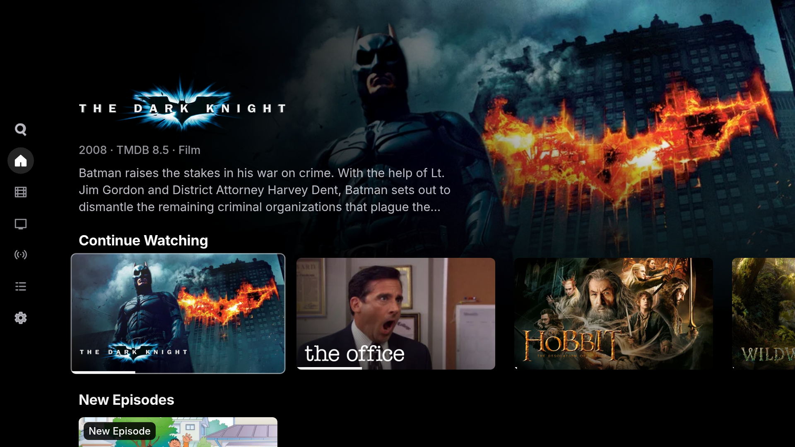

# Couch TV

A good-looking app for watching films, series and live sports on a Samsung smart TV.

- Browse trending films and series, search, and keep a My List.
- Pick up where you left off, with subtitles and the next episode playing on its own.
- Scores, fixtures and tables for football and cricket, including the Nepal Premier League.
- Works as soon as it's installed. Add your own Stremio add-ons, stream server or IPTV playlist if you like.

## Install

Couch TV isn't in Samsung's app store, so it's installed from a computer (Linux or Mac) on the same Wi-Fi as
the TV. You need a Samsung TV from 2019 or later, and a free Samsung account.

### The easy way: let an AI agent do it

If you use an AI coding agent (Claude Code, Codex, Cursor and the like), open it on your computer and paste:

> Clone https://github.com/aabhiojha/couch-tv and install Couch TV on my Samsung TV by following its
> AGENT_INSTALL.md.

It installs the tools and builds the app for you. It'll stop and ask you for three things only you can do:

1. Turn on Developer Mode on the TV (a menu on the TV; it tells you where).
2. Sign in to your Samsung account once, so the app is allowed on your TV.
3. Paste a free key from [TMDB](https://www.themoviedb.org/settings/api), where the film and series pages
   come from. You can also skip this and type it on the TV.

### By hand

[INSTALL.md](INSTALL.md) has the same steps, written for people. Allow about 30–60 minutes the first time.

## Using it

Arrows and OK to move around, Back to go back. ▶ starts a title straight away, and 0–9 jump through it
(5 = halfway). The [user guide](docs/user-guide.md) covers every screen, and Settings lets you change the look,
the menu position and more.

To update later, run `git pull`, then `TV=<your TV's IP> ./build.sh install` (or ask your agent to update
Couch TV). Your history and My List are kept.

## Help

- **The app disappeared:** Developer Mode got turned off. Turn it on and install again.
- **Anything else:** see [If something goes wrong](INSTALL.md#if-something-goes-wrong), or
  [open an issue](https://github.com/aabhiojha/couch-tv/issues) with your TV model.

Developers: the [docs](docs/README.md) explain how it's built and tested. Pull requests are welcome; run
`./build.sh` first and say which TV you tested on.

## Disclaimer

Couch TV hosts no content. Out of the box it finds streams on third-party sites and torrents it doesn't
control; those may not be licensed where you live, and using them is your responsibility. Couch TV isn't
affiliated with Samsung, TMDB, Stremio or any of those sources.

[MIT licence](LICENSE), except `tv-service/CouchTor.Core/Streams/`, which is
[PolyForm Noncommercial](tv-service/CouchTor.Core/Streams/LICENSE) (no commercial use).
Torrents via [MonoTorrent](https://github.com/alanmcgovern/monotorrent) (MIT). Film and series data from
[TMDB](https://www.themoviedb.org); this product uses the TMDB API but is not endorsed or certified by TMDB.
